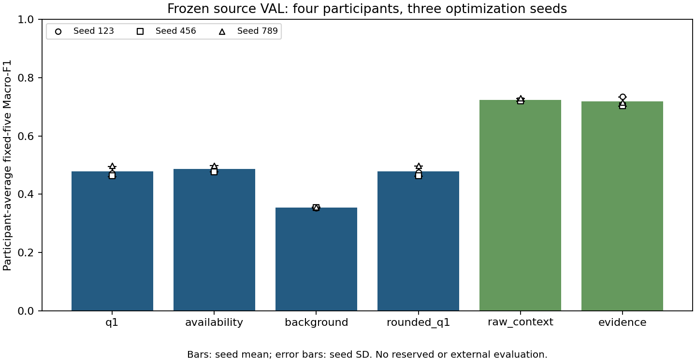
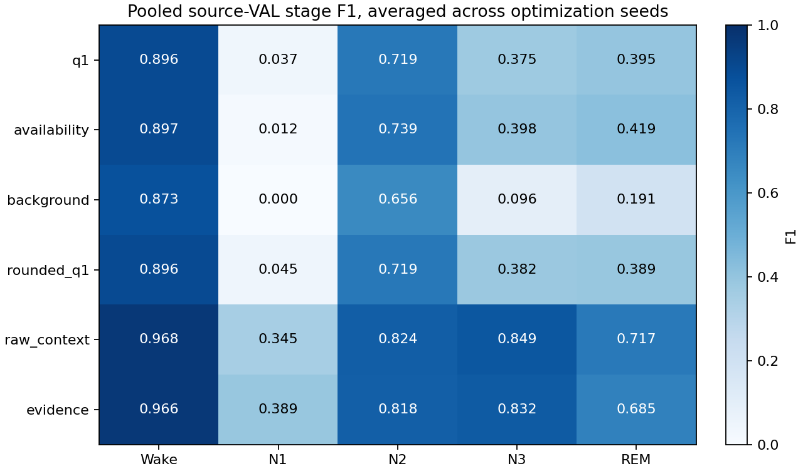

# Phase III real Sleep-Cassette source experiment v1 — complete

MIST-COVE’s minimal 75-parameter analytic evidence model does **not** demonstrate competitive source-validation performance against the existing trained baselines. Its local event pathway adds predictive information over its own background-only control, but this does not establish clinical waveform-event recognition or faithful individual causal attribution. Retain q1 as a simple reference and this completed negative result; do not advance this candidate to reserved or external evaluation.

All 18 prespecified runs completed under the unchanged recipe: **915 epochs and 4,554,870 optimizer updates**. Source identities, original physical prediction grids, scoring masks, earliest-best checkpoint selection, optimizer steps, original seed-123 epoch-one boundaries, environment and all completion seals were reverified. No integrity or numerical failure occurred during Gate B. The original Phase I H1 failure, Phase II limitations and historical P3B reports are unchanged.

## Authorization and identity

The actual user message “Decision: APPROVE_GATE_B — MIST-COVE Phase III” separately authorized Gate B after Gate A. Its SHA256 is `697c0f5fa140f62240bc97e4968cd2ef6edeca53914f8dd759974e2e6d0c8439`. The original Gate A-only review was not rewritten or extended. An operational supervisor verified the separate actual Gate B record before invoking the unchanged runner with its original launch identity. This is a transcription of an actual user decision, not agent approval.

- Reviewed Gate A commit: `ed963a828ea92a551a554f2e332cd097b25cb013`.
- Frozen scientific implementation commit: `a601e8e004b9e0c2942e83d4517fb8a47856de72`; implementation inventory SHA256 `d08254fade1b8ba91715143c44c7043f88956eba937984557a011609f0a6bda9`.
- Launch proposal SHA256: `8282be8a6d7124a0fd6e83a4ae8b8e273919fc0b7976a756389e8088d3ec38b0`.
- Frozen source configuration canonical SHA256: `af81748149c1bfb3c18dcf5c009c0a9f95bcabdc5a623ecc1e2b7d0b7420df46`.
- Frozen split fingerprint: `3e7a7260aae50ca522752f1cede41246daf1b2f6a8fd482800cfda97b4564e84`; split file SHA256: `1162a41098bb8a724a0b8bf8bb320469c2b1c02bb802d9b5cf7f2e49d2da54e5`.
- Four new analytic candidates and both unchanged historical baseline definitions were trained at seeds 123, 456 and 789. Every seed-123 run resumed from its verified sealed epoch-one model/optimizer/RNG state; none replayed Gate A.

Authorization remains limited to 15 TRAIN people / 29 nights and four VAL people / eight nights. TRAIN has 79,984 physical / 79,025 scored epochs; VAL has 21,796 physical / 21,789 scored. All 74 authorized original PSG/annotation file hashes, TRAIN normalization and three frozen TRAIN banks were checked before resumption and after analysis. The canonical raw-EDF descriptors were used, including the previously documented case-sensitive directory discrepancy. No legacy NPZ substitution or new fitting occurred. The 55 RESERVED subjects, Sleep-Telemetry and SHHS were not accessed.

Inputs remain calibrated single-channel EEG Fpz-Cz in µV, 100 Hz, 3,000 samples per original 30-second physical epoch. R&K stages 3/4 merge into N3. Movement, unknown and unscored positions retain their physical coordinates and masks. Normalization remains the verified TRAIN-only artifact; there is no label-dependent trimming, gap compression, undocumented filtering/resampling or VAL-based fit.

## Frozen comparison and source results

AdamW lr 0.0003, weight decay 0.0001, maximum 60 epochs, patience 12, core/encoding batch 16, gradient clipping 5, deterministic FP32, AMP/TF32 disabled, temporal radius zero, no CRF or new augmentation. Checkpoints use participant-average fixed-five VAL Macro-F1, improving by more than 1e-8 and retaining the earliest best on ties. Every scored TRAIN epoch is used once per epoch without crossing a night or unscored gap; VAL inference covers the complete physical grid before metric masking.

Values below are means ± sample SD over three optimization seeds. These are source-VAL selected checkpoints on the same four people; the seeds are not independent participants or confidence intervals. Stage metrics pool the scored VAL epochs within each seed. Between-participant statistics pool each person’s nights and then average their three seed scores.

| Method | Participant Macro-F1 | Pooled Macro-F1 | Accuracy | Kappa | Balanced accuracy |
|---|---:|---:|---:|---:|---:|
| q1 | 0.477645 ± 0.018154 | 0.484328 ± 0.017638 | 0.801582 ± 0.004452 | 0.563877 ± 0.013388 | 0.452764 ± 0.016385 |
| availability | 0.487475 ± 0.010807 | 0.492811 ± 0.012292 | 0.805223 ± 0.001101 | 0.578399 ± 0.009027 | 0.467633 ± 0.014471 |
| background | 0.354091 ± 0.001672 | 0.363151 ± 0.001658 | 0.769364 ± 0.000390 | 0.452567 ± 0.001251 | 0.353584 ± 0.000795 |
| rounded_q1 | 0.478864 ± 0.017272 | 0.486297 ± 0.017516 | 0.801811 ± 0.004602 | 0.564746 ± 0.014291 | 0.454029 ± 0.016767 |
| raw_context | 0.723511 ± 0.005192 | 0.740560 ± 0.004202 | 0.905136 ± 0.001970 | 0.810789 ± 0.003110 | 0.727949 ± 0.003068 |
| evidence | 0.718031 ± 0.016188 | 0.738142 ± 0.015252 | 0.899812 ± 0.005372 | 0.800456 ± 0.010880 | 0.727416 ± 0.017096 |



**PASS — prespecified event-path utility:** q1 exceeds background in all three paired optimization seeds by 0.119319, 0.108699, 0.142647. Its mean gain is 0.123555. The background-only model does not explain all of the classification gain. This comparison isolates adding local spectral/amplitude evidence to this small background representation, not confirmed physiological morphology.

**FAIL — prespecified source competitiveness:** q1’s mean is 0.245866 below raw_context and 0.240386 below evidence. None of the four analytic variants reaches either strong baseline. Availability has a slightly higher descriptive mean than q1, but its stage-shared fixed spectral/amplitude heuristic remains uncalibrated as observability; this result does not reverse the failed Phase I H1 risk–coverage test or demonstrate gating necessity.

| Method | Wake F1 | N1 F1 | N2 F1 | N3 F1 | REM F1 |
|---|---:|---:|---:|---:|---:|
| q1 | 0.895718 | 0.037354 | 0.719481 | 0.374545 | 0.394543 |
| availability | 0.896909 | 0.011828 | 0.738532 | 0.397514 | 0.419273 |
| background | 0.872773 | 0.000000 | 0.655776 | 0.096188 | 0.191017 |
| rounded_q1 | 0.896000 | 0.045210 | 0.719440 | 0.382135 | 0.388702 |
| raw_context | 0.968489 | 0.344897 | 0.824028 | 0.848537 | 0.716848 |
| evidence | 0.966474 | 0.388668 | 0.817981 | 0.832331 | 0.685258 |



| Method | Wake recall | N1 recall | N2 recall | N3 recall | REM recall |
|---|---:|---:|---:|---:|---:|
| q1 | 0.962007 | 0.020902 | 0.694752 | 0.255839 | 0.330321 |
| availability | 0.955186 | 0.006051 | 0.714106 | 0.283705 | 0.379116 |
| background | 0.974618 | 0.000000 | 0.623278 | 0.051752 | 0.118273 |
| rounded_q1 | 0.961732 | 0.025303 | 0.697272 | 0.261943 | 0.323896 |
| raw_context | 0.985878 | 0.271177 | 0.781709 | 0.873673 | 0.727309 |
| evidence | 0.982674 | 0.350385 | 0.790350 | 0.884554 | 0.629116 |

q1 N1 recall is only 0.020902, and N3/REM recall is 0.255839/0.330321. Background predicts no N1 at every selected checkpoint. No final selected checkpoint is a one-class or ≥98% collapse, but the analytic models retain marked Wake dominance. Early selected-best collapse/near-collapse snapshots were monitored without intervention. That asynchronous observer does not constitute complete confusion matrices for every non-best epoch; final sealed checkpoints and every epoch’s finite/selection history were fully audited.

| Method | NLL | Brier | ECE15 | Between-person SD | Between-person min–max |
|---|---:|---:|---:|---:|---:|
| q1 | 0.694032 | 0.295674 | 0.039343 | 0.064560 | 0.415657–0.564706 |
| availability | 0.561636 | 0.284394 | 0.029632 | 0.051647 | 0.436240–0.559339 |
| background | 0.701015 | 0.332458 | 0.052854 | 0.069510 | 0.270685–0.428291 |
| rounded_q1 | 0.695000 | 0.295815 | 0.040008 | 0.066056 | 0.416609–0.568394 |
| raw_context | 0.393862 | 0.147073 | 0.037467 | 0.068409 | 0.623179–0.772687 |
| evidence | 0.417187 | 0.155107 | 0.026670 | 0.070989 | 0.611691–0.758169 |

ECE is an imbalanced full-grid summary, not stage-pair observability or clinical calibration. q1 has worse NLL/Brier than both trained baselines. Per-seed metrics, fixed-five absent-class policy, confusion matrices, calibration SDs, prediction counts and anonymous paired participant-difference summaries are retained in [source_results.json](../../reports/mist_cove/phase3_source_v1/source_results.json); [source_metrics.csv](../../reports/mist_cove/phase3_source_v1/figures/source_metrics.csv) provides the 18-run table. Participant identities and individual prediction files remain local.

## Real GPU execution and realized budgets

Actual device: **NVIDIA GeForce RTX 4080 SUPER**, 16,718,168,064 bytes. Reconciled Python 3.12.9, NumPy 1.26.4, PyTorch 2.5.1, CUDA build 12.1, cuDNN 90100; deterministic FP32, no AMP/TF32. The prior NumPy import/metadata mismatch was resolved by the isolated Phase III environment, without repairing historical environments. See the preserved preflight report and [execution_receipt.json](../../reports/mist_cove/phase3_source_v1/execution_receipt.json).

Gate A’s maximum 18-run estimate was **14.007785 GPU hours**, with no early-stop discount; the monitor’s conservative estimate never exceeded that value or the 24-hour gate. Gate B’s measured enclosing exclusive-GPU wall was **37,984.386 seconds (10.551218 hours)**. Gate A’s six initial epoch/checkpoint measurements sum to **280.156 seconds (0.077821 hours)**. Their known measured sum is **10.629039 hours**; surrounding Gate A setup was not separately timed. Summed epoch wall across all 18 runs is **38123.695 seconds**; it excludes checkpoint/setup/final reevaluation overhead. GPU kernel execution time was not profiled. Read-only final verification took 2.415 seconds and the separate waveform audit 170.802 seconds. These timings are not identical-actual-compute claims.

| Method | Parameters / trainable | Epochs (three seeds) | Updates | Epoch wall hours | Peak allocated MiB | Peak reserved MiB |
|---|---:|---:|---:|---:|---:|---:|
| q1 | 75 / 75 | 180 | 896,040 | 1.686109 | 65.990 | 68.000 |
| availability | 75 / 75 | 180 | 896,040 | 1.686935 | 65.990 | 68.000 |
| background | 75 / 75 | 180 | 896,040 | 1.650086 | 65.987 | 68.000 |
| rounded_q1 | 75 / 75 | 180 | 896,040 | 1.677879 | 65.990 | 68.000 |
| raw_context | 34197 / 33957 | 83 | 413,174 | 1.203588 | 185.032 | 232.000 |
| evidence | 13556 / 13556 | 112 | 557,536 | 2.685317 | 186.479 | 246.000 |

All analytic candidates retain 75 declared trainable parameters; background’s 35 event-head parameters are disconnected from its decision, leaving 40 effective background parameters. It still runs the frozen detector, so it is not an optimized inference implementation. Allocator peaks exclude CUDA context/driver/display allocations. Process-lifetime CPU RSS reached about 1.726 GiB and is not an isolated per-model peak. Every epoch performs 4,978 optimizer updates. Maximum budgets match; realized epochs and compute differ.

| Method | seed 123 best / stop | seed 456 best / stop | seed 789 best / stop |
|---|---:|---:|---:|
| q1 | 60 / 60 | 51 / 60 | 54 / 60 |
| availability | 60 / 60 | 58 / 60 | 54 / 60 |
| background | 60 / 60 | 60 / 60 | 60 / 60 |
| rounded_q1 | 60 / 60 | 51 / 60 | 54 / 60 |
| raw_context | 28 / 40 | 7 / 19 | 12 / 24 |
| evidence | 33 / 45 | 18 / 30 | 25 / 37 |

All analytic runs exhausted the unchanged 60-epoch maximum; several selected their final epoch. This experiment does not establish their asymptotic convergence or separate representation capacity from optimization-budget limitations. No epoch extension, larger encoder, class reweighting or hyperparameter response to weak N1 performance was introduced.

**Historical P3B comparison:** the new raw_context mean 0.723510918 and evidence mean 0.718031414 reproduce the historical rounded means 0.723511 and 0.718031. In all six new baseline runs, participant and pooled Macro-F1, selected epochs and stopping epochs exactly match their historical public rows. These are independently rerun optimizer histories and new sealed outputs, not reused historical scores/checkpoints. Equality supports software/protocol reproducibility on the same source data; it is not independent scientific validation. The historical checkpoints, training code, split and reports were not modified.

## Waveform evidence: estimands, failures and limits

The parent waveform protocol was committed before scores. The detailed plan and exact 200-epoch private sample list were frozen before any Gate B run completed, after intermediate VAL scores already existed. The sample uses the earliest five scored physical epochs per stage per VAL recording: 40 epochs/stage, the same 200 positions for each of 12 analytic model/seed combinations. It is label-stratified and nonrepresentative; its 2,400 model/example observations are not 2,400 independent epochs or participants. Supplemental transforms, same-band groups and correlation summaries are descriptive analysis, not newly confirmed clinical hypotheses.

The audit keeps A signed additive scores, B individual full-model waveform effects, C predeclared joint-group effects and D selection stability separate. For every stage, full effect reconciles as background change + fixed-witness internal event-path change + reselection change. The maximum absolute residual across all analyzed groups/models is **1.430512e-6**, below the frozen 1e-5 tolerance. Fixed-witness paths are internal model interventions, not necessarily physiological counterfactuals. Removing the selected set leaves other candidate windows available for reselection.

| Method | Mean five-logit A-versus-joint-effect L1 | Background effect L1 | Fixed event-path L1 | Reselection L1 | Joint versus sum-of-individual L1 |
|---|---:|---:|---:|---:|---:|
| q1 | 10.145351 | 2.296615 | 13.654815 | 11.768624 | 3.622493 |
| availability | 5.723040 | 2.175120 | 10.183386 | 7.668649 | 2.861922 |
| background | 2.795906 | 2.795906 | 0.000000 | 0.000000 | 1.142654 |
| rounded_q1 | 10.211054 | 2.402923 | 13.721472 | 11.834764 | 3.879040 |

L1 norms are separately measured magnitudes, not additive signed terms. In q1, joint true-stage absolute effects average 1.146861 logits versus 0.676664 for the largest individual effect; joint magnitude exceeds the largest individual by 0.25 in 61.17% of repeated model/examples (descriptive supplement). Spectral cosine similarity among selected windows averages 0.962580, and every epoch has a predeclared group of at least two delta-dominant witnesses. Similarity and joint dependence are consistent with redundancy/complementarity; neither identifies a unique physiological cause.

Adjacent target intervals are unioned before constructing the joint bridge. A bridge spanning a merged interval can differ from composing the individual two-second bridges, including their endpoints and internal blends. Joint-versus-individual discrepancies therefore combine donor geometry, global-feature changes, nonlinearities and reselection. This comparison does not isolate physiological redundancy or prove group explanations are clinically more faithful. Spectral similarity is between five-band fraction vectors, not independently measured waveform or clinical-event equivalence.

**Individual attribution remains weak:** across all five stage components, q1 additive-versus-individual-full-effect correlations are 0.251157, 0.277013 and 0.255766, with mean absolute differences 0.551686–0.559178 logits. Nonzero sign agreement is about 58–60%. The availability comparison’s correlations are 0.543961–0.566005, still not an identity or causal guarantee. Background has exactly zero event scores but nonzero waveform effects through global features, making its score/effect correlation undefined. Do not force these different estimands to agree or present their equality as the definition of additive faithfulness.

**FAIL — existing background donor compatibility on these real examples:** zero of 200 examples for every model/seed had a disjoint 200-sample candidate below the unchanged 3-µV centered-RMS cap. The smallest rejected minimum is 3.186827 µV, with median about 7.970160 µV. The cap was not relaxed. Therefore the planned bridge-versus-background donor comparison and donor sensitivity are **NOT TESTED**, with null spreads rather than fabricated agreement. Bridge-only results cannot resolve the known Phase II donor-dependence limitation.

All bridge replacements passed the elementary numerical/boundary guard and preserve boundary jump values, yet for q1 mean relative energy mismatch is 0.653091 and mean spectral-fraction L1 distortion is 0.455839. Boundary continuity does not make a bridge physiologically plausible. The 20-sample blends do not certify clinical validity.

| Selection | Tiny noise mean Jaccard distance | 1% physical gain | 10-sample temporal shift |
|---|---:|---:|---:|
| Hard q1 | 0.000000 | 0.000000 | 0.247667 |
| Rounded q1 | 0.000000 | 0.081333 | 0.253524 |

Rounded bins introduce real gain-boundary sensitivity and do not improve these sampled stability outcomes. The temporal metric compares exact selected sample intervals without shift realignment; it is not a clinical invariance test. The background control still computes selections for analysis, but they carry zero event decision contributions.

On this difficult, early label-stratified subset, q1 accuracy averages 0.390 while confidence averages 0.671944. Bridge-replaced accuracy averages 0.418333 with confidence 0.647802; maximum confidence increases in 45.83% of examples, and 4.17% of repeated examples are incorrect with confidence ≥0.9 after replacement. These exploratory summaries describe the fixed interventions, not representative full-grid calibration or a new acceptance threshold. Removing selected waves can improve a decision; confidence alone does not establish diagnostic evidence.

Forty q1 seed-123 waveform/time-frequency/signed-score figures were saved locally. Manual inspection of the deterministic first available N2, N3, N1 and REM previews found prominent low-frequency/high-amplitude transients in selected N2/N1 intervals, visible slow oscillations in N3, and lower-amplitude mixed activity in REM. The viewed N2/N3/N1 examples were misclassified as REM/N2/Wake; the REM example was correct. These four previews are illustrative, not a new curated success set or systematic event validation. No selected waveform is confirmed as a spindle, K-complex, clinical slow wave or REM biomarker. The analytic five-band/RMS representation and amplitude-based selector lack an independently evaluated clinical event or learned morphology encoder.

## Correctness, publication and stop decision

- **PASS:** full CPU suite 398 passed, zero failed/errors, 11 CUDA skips; 17 added generated-input postfit/waveform checks are included. One existing PyTorch nested-tensor warning remains.
- **PASS:** separate prelaunch CUDA suite 11 passed, zero failed/skipped; six-method standalone exact interrupted-versus-uninterrupted model/optimizer/Python/NumPy/CPU/CUDA RNG/history checks passed. They remain bound to the unchanged scientific implementation and reconciled environment.
- **PASS:** all 18 finite completed runs, 915 epoch histories, 4,554,870 updates, six original Gate A boundaries, complete physical VAL prediction grids, metric masking, checkpoint selection and output seals reverified. Sources/normalization/banks/environment remained unchanged after real waveform analysis.
- **PASS:** prespecified q1 versus background source utility.
- **FAIL:** prespecified competitiveness against both strong baselines. The real rounded selector also fails to improve the sampled gain/shift stability descriptively; individual additive scores remain poor proxies for full intervention magnitudes.
- **NOT TESTED:** physiological counterfactual validity, independently confirmed clinical events, representative clinical explanation usefulness, donor robustness requiring an admissible second donor, asymptotic capacity/convergence, reserved performance or cross-study transfer.
- **BLOCKED:** RESERVED/ST/SHHS evaluation and target adaptation have no authorization. The second-donor comparison is prevented by the unchanged compatibility guard. No training launch or integrity gate remains blocked; all prescribed runs finished.

Further development would require a separately versioned source-only hypothesis and approval: for example, a compact local encoder tested for specific temporal morphology against a matched spectral-only control, plus a TRAIN-derived and independently justified donor protocol. Any clinical event claim needs independent event criteria. Keep this frozen comparison intact, retain q1 as the simple reference, and do not add capacity or refit donors in this experiment. Do not automatically access RESERVED, Sleep-Telemetry or SHHS.

## Reproducible commands and artifacts

The frozen trainer/config were committed before preflight and training. The operational and analysis scripts executed from the ignored run root are archived byte-for-byte in [analysis/mist_cove_phase3_v1](../../analysis/mist_cove_phase3_v1/README.md); source hashes and human-authorization references are in the aggregate execution receipt. Operational launch sources require the original reviewed commit, private authorization and sealed epoch-one files and are not replay instructions for an already completed run. Analysis outputs refuse overwrite.

```bash
# Executed once after the actual separate Gate B approval, at reviewed HEAD ed963a8:
OMP_NUM_THREADS=2 OPENBLAS_NUM_THREADS=2 CUBLAS_WORKSPACE_CONFIG=:4096:8 \
  mist_transfer_runs/mist_cove/phase3_source_v1/environment/bin/python \
  mist_transfer_runs/mist_cove/phase3_source_v1/launch_gate_b_v1.py

# Generated-input regression only; hides the GPU from the test process:
PYTHONPATH=src CUDA_VISIBLE_DEVICES='' OMP_NUM_THREADS=2 OPENBLAS_NUM_THREADS=2 \
  mist_transfer_runs/mist_cove/phase3_source_v1/environment/bin/python -m pytest tests -q

# Postfit commands executed only after all 18 sealed completions:
mist_transfer_runs/mist_cove/phase3_source_v1/environment/bin/python mist_transfer_runs/mist_cove/phase3_source_v1/collect_phase3_results_v1.py
mist_transfer_runs/mist_cove/phase3_source_v1/environment/bin/python mist_transfer_runs/mist_cove/phase3_source_v1/waveform_analysis_v1.py
mist_transfer_runs/mist_cove/phase3_source_v1/environment/bin/python mist_transfer_runs/mist_cove/phase3_source_v1/individual_attribution_summary_v1.py
mist_transfer_runs/mist_cove/phase3_source_v1/environment/bin/python analysis/mist_cove_phase3_v1/supplemental_audit_summary_v1.py
```

Public outputs are aggregate JSON, the 18-run metric CSV and two aggregate figures. Actual source paths, subject-linked metrics, full predictions, models/RNG/optimizer states, fitted artifacts, source ledgers and all real waveform plots remain ignored locally. Earlier phase and P3B scientific reports are immutable. This completed phase stops before reserved or external evaluation.
