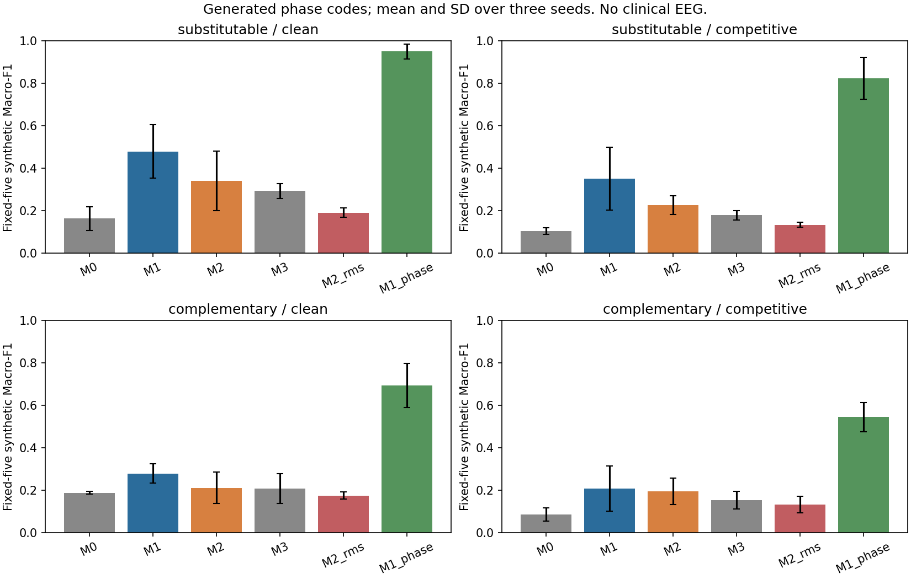

# Phase IV learned morphology v1 / corrected synthetic protocol v2

**Scientific decision: retain this implementation as a falsified/simple research reference; do not launch a new real EEG campaign.** The compact waveform encoder and exactly matched heads are implemented, audited and tested, but the main synthetic morphology and explanatory-organization criteria fail. A phase-removed, spectrum-preserving internal control classifies these generated tasks much better. This exposes a strong alternative explanation rather than demonstrating temporal morphology necessity. Nothing in this phase establishes real sleep-stage performance or transfer.

## Identity, CI repair and permitted scope

- Base Phase III: `4095c805cfd48fbb1e9ef938dbc46da28ed1dfb1`; branch `research/mist-cove-phase4-morphology-v1`; [draft PR #6](https://github.com/SyedNaveedMahmood/Proto-sleep/pull/6), targeting the Phase III branch.
- Separate CI repair commit: `165507b9ccdc0b4d8c6797bb14c6e924be3c0a7f`. [Actual repaired workflow PASS](https://github.com/SyedNaveedMahmood/Proto-sleep/actions/runs/39256405101) before model implementation.
- Original preregistration: `2dbc09b`; initial implementation: `f3519ffa7db406bff34e19a50229a66228ad8a49`.
- Corrected generator/implementation freeze: `fdc4c5ab8a95107397de286a4f5093c844d7e979`; [actual corrected-model workflow PASS](https://github.com/SyedNaveedMahmood/Proto-sleep/actions/runs/39259389692).
- Tested implementation inventory SHA256: `e8f84002bd71a57259e596a547b101b5733e2d7a755b45bed706a830ff59142d`; config canonical SHA256 `08dbe788f07b2c1f732525da8dc8ed24967c7c9fc9d0537ad6835fd3c79a3255`.
- Original and corrected preregistrations, configs and matrices are preserved. The [v2 geometry amendment](PHASE_IV_GENERATOR_AMENDMENT_V2.md) records the first launch failure before model training/scores. No acceptance criterion, model or training budget changed. A separate development argsort API error was fixed before that launch and covered by plumbing tests.

The [CI root-cause report](../CI_CPU_V1.md) explains the missing MNE/PyEDFlib dependencies: they were in an audit requirements file, not the installed development extra. The full test extra and optional EDF runtime extra now declare their requirements. Ubuntu 24.04 / Python 3.12.9 / constrained scientific packages / official torch 2.5.1+cpu avoid CUDA toolchain downloads; pip check and CPU-only verification pass. Features use PR checks, main retains direct-push checks, and superseded PR checks cancel. No blanket exclusion, deleted test or continue-on-error hides failures.

Only synthetic training, generated EDF/mock integration and published safe historical aggregates were used. No real TRAIN/VAL EEG or source descriptors, reserved EEG/annotations/descriptors, Sleep-Telemetry, SHHS, legacy NPZ or fitted real artifacts were opened. Historical Phase I–III/P3B scientific sources, splits, configs and results remain unchanged. The Phase III failure remains a completed negative result; this phase does not reinterpret it.

## Architecture and fairness

The [model specification](PHASE_IV_MODEL_SPEC_V1.md) defines four-second / stride-two-second candidate patches from calibrated 100-Hz, 3,000-sample input. A small multiscale CNN processes relative waveform shape and physical amplitude in parallel, returning 18 local features. The same encoder design, receptive support, initialization and training recipe serve M1/M2/M3/M2_rms/M1_phase. M1 pools mean/max and uses an ordinary linear head. M2 adds a mean-background head to four signed local event scores, ranked by learned stage contrast; M2_rms changes ranking only. M3 disables local evidence. No availability, attention, MoE or prototype mechanism is added.

| Model | Total parameters | End-to-end trainable | Fixed-encoder head trainable |
|---|---:|---:|---:|
| M0, unchanged historical q1 | 75 | 75 | not used |
| M1 conventional | 3,593 | 3,593 | 185 |
| M2 additive | 3,593 | 3,593 | 185 |
| M3 evidence-disabled | 3,593 | 3,503 | 95 |
| M2_rms | 3,593 | 3,593 | not used |
| M1_phase | 3,593 | 3,593 | not used |

The encoder has 3,408 parameters. M1 and M2 have exactly 185 head parameters each, without unused padding parameters. M3 retains 90 disabled event-head parameters. For the primary head comparison, M1/M2/M3 share byte-identical final TRAIN-only M1 encoder weights, freeze them, discard the pretraining head and reset/refit all heads for identical exposure. The published collector verifies every encoder digest against its common parent. End-to-end weights can diverge and are not described as fixed-identical learned representations. Conventional pretraining may itself favor conventional organization; this comparison does not establish an optimal evidence pretraining objective.

Equal parameters do not make the head function classes identical: mean/max linear pooling and bounded sparse signed aggregation impose different constraints. Their comparison tests those defined organizations, not interpretability in isolation from every functional choice. All methods encode fourteen patches before selection, so sparse evidence does not save encoder computation. M1_phase adds FFT work; fixed-encoder fits cache common features. Per-run gradient activity and timing are reported rather than asserting equal realized compute or identical effective expressivity.

## Executed synthetic experiment

Two invented five-class phase-code tasks, three seeds 123/456/789, six end-to-end models and three fixed-encoder heads produced **54 completed fits / 13,500 optimizer updates / 216,000 example exposures**. Every end-to-end fit used 300 balanced generated TRAIN examples and 300 mini-batch-16 AdamW updates (lr .001, wd .0001, clip 5). Each common-encoder head used 150 updates. No held-out checkpoint selection, early stopping, architecture sweep or localization training labels were used. Identical methods receive identical minibatch indices. Common encoder pretraining is already counted in the M1 end-to-end fits, not charged repeatedly as new encoder optimization.

Each fit evaluated ten fixed conditions with 100 fresh examples (20 per synthetic class): clean, single, redundant, correlated, competitive, abrupt artifact, overlap, partial loss, erased and eventless. First one-per-class examples in six conditions received oracle/bridge/independent-background audits. All are synthetic annotations and fixed template families; held-out variation concerns noise, amplitudes and positions, not independent clinical events or unseen waveform families.



| Task | End-to-end method | Clean F1 mean ± seed SD | Competitive F1 mean ± seed SD | Competitive top-ranked localization | Erased confidence |
|---|---|---:|---:|---:|---:|
| substitutable | M0 | 0.1633 ± 0.0557 | 0.1037 ± 0.0158 | 0.0000 | 0.2942 |
| substitutable | M1 | 0.4794 ± 0.1254 | 0.3502 ± 0.1480 | 0.2633 | 0.4151 |
| substitutable | M2 | 0.3410 ± 0.1400 | 0.2260 ± 0.0443 | 0.1433 | 0.4100 |
| substitutable | M3 | 0.2928 ± 0.0360 | 0.1789 ± 0.0216 | 0.1667 | 0.2550 |
| substitutable | M2_rms | 0.1909 ± 0.0217 | 0.1337 ± 0.0116 | 0.0533 | 0.3842 |
| substitutable | M1_phase | 0.9503 ± 0.0358 | 0.8242 ± 0.0982 | 0.2667 | 0.5207 |
| complementary | M0 | 0.1877 ± 0.0067 | 0.0849 ± 0.0316 | 0.0000 | 0.3195 |
| complementary | M1 | 0.2781 ± 0.0453 | 0.2079 ± 0.1056 | 0.1467 | 0.4271 |
| complementary | M2 | 0.2113 ± 0.0735 | 0.1949 ± 0.0627 | 0.1733 | 0.3750 |
| complementary | M3 | 0.2079 ± 0.0708 | 0.1539 ± 0.0412 | 0.1667 | 0.2638 |
| complementary | M2_rms | 0.1750 ± 0.0174 | 0.1324 ± 0.0379 | 0.0500 | 0.3808 |
| complementary | M1_phase | 0.6938 ± 0.1043 | 0.5451 ± 0.0687 | 0.3267 | 0.5111 |

F1 is fixed-five. Seed SD describes optimization/generator repeats, not participants or a clinical confidence interval. Conventional localization is an internal leave-one-candidate feature-deletion ranking, explicitly distinct from native additive scores or full waveform effects.

**FAIL H4.1 (0/3 primary seed comparisons):** M1 does not exceed the same-capacity phase-removed control by the frozen 0.10 margin. The latter is stronger in every seed. Whole template spectra are matched, but overlapping/cropped candidate spectra can retain class information, and deterministic phase removal can change learning difficulty. Original temporal phase is unnecessary for this task’s best observed classification. The result does not prove that temporal morphology is useless on clinical EEG; it invalidates a unique morphology-necessity reading of these constructed fixtures. M1 outperforming the tiny five-band q1 alone is insufficient.

| Task | Fixed encoder head | Clean F1 | Competitive F1 | Competitive localization |
|---|---|---:|---:|---:|
| substitutable | M1 | 0.3652 | 0.2945 | 0.2867 |
| substitutable | M2 | 0.3133 | 0.2452 | 0.2000 |
| substitutable | M3 | 0.2221 | 0.1851 | 0.2467 |
| complementary | M1 | 0.2451 | 0.2060 | 0.1333 |
| complementary | M2 | 0.2459 | 0.2117 | 0.1667 |
| complementary | M3 | 0.1760 | 0.1484 | 0.1500 |

**FAIL H4.2 (0/6 task/seed comparisons):** fixed-encoder M2 does not reach 0.80 top-ranked localization or establish the required ≥0.10 advantage over conventional feature-deletion ranking. On the substitutable task it localizes worse in all three seeds and loses more than 0.03 clean F1 at seed 789. Some oracle selected-minus-control effects are positive, but these alone do not satisfy the compound organization claim. All head weights had matched budgets and common encoder digests.

**FAIL robust H4.3:** the plural-dependence criterion passes only complementary seed 456 (1/6), while donor robustness passes 0/6. M2 redundant/correlated selected sets are stable to tiny 0.01-µV noise (mean Jaccard distance zero in these audits), but stable selection does not ensure relevant evidence or strong group dependence. Joint effects often fail to exceed the largest individual by 0.25. Erased confidence means are below 0.5 for primary M2, but this alone cannot pass the plural mechanism. A single repeated seed success is not general confirmation.

**FAIL consistent learned distractor advantage:** the frozen joint F1/localization advantage over RMS ranking passes only complementary seed 456 (1/6). Mean M2 competitive localization is 0.1433/0.1733 across the two tasks, versus 0.0533/0.0500 for RMS. Improvement is inconsistent and far below the organization target. A learned scorer can ignore energy by construction in a unit fixture; learned models did not demonstrate the required robust behavior.

## Evidence accounting and intervention limits

Exact signed five-stage logits reconcile as background plus selected event contributions. Original half-open intervals, candidate ranks, local representations, validity and physical waveform hashes remain available. Metadata ledger tests preserve original source epoch offsets and scoring masks without opening any source data. Maximum full counterfactual residual across all audited groups/methods is **5.960464e-7**, below 1e-5.

The report separately retains original event scores, background scores, individual full-model effects, fixed-witness/internal event-path effects, reselection, group effects, donor spread and compatibility diagnostics. A native event’s score is not the sum of every overlapping selected event, and neither is equated with waveform necessity. Replacing a window may alter overlapping witnesses, global pooled features and selection. Joint bridges union adjacent/overlapping targets and may differ geometrically from individual bridges; oracle subtraction removes known generated diagnostic components separately. Numerical continuity/energy checks do not certify physiology.

| Task | M2 seed | Clean group donor spread | Native first-event / full-interval bridge MAE |
|---|---:|---:|---:|
| substitutable | 123 | 0.316643 | 0.568232 |
| substitutable | 456 | 0.360401 | 0.252536 |
| substitutable | 789 | 0.096218 | 0.384683 |
| complementary | 123 | 0.535946 | 0.281976 |
| complementary | 456 | 0.499439 | 0.259830 |
| complementary | 789 | 0.626544 | 0.212026 |

Mean group donor spread exceeds 0.25 in at least one condition for every M2 task/seed. These effects remain donor-conditional. Complete per-seed confusion, class F1/recall, NLL/Brier/ECE, clean/corrupted confidence, localization/overlap, signed individual/group vectors, unsupported counts and reselection diagnostics are in [per_run_v2.jsonl](../../reports/mist_cove/phase4_v1/per_run_v2.jsonl); [aggregate_v2.json](../../reports/mist_cove/phase4_v1/aggregate_v2.json) summarizes all ten conditions. No waveform or learned weight is public.

M2 confidence increases under stronger competition despite lower accuracy. Its substitutable clean/competitive mean confidence is 0.4400/0.4995, with ECE 0.1162/0.2708; complementary confidence is 0.3989/0.4775, with ECE 0.1706/0.2550. Fully erased conditions are near chance F1 while confidence remains 0.4100/0.3750. Flat eventless input has no fabricated native witnesses, but still yields a background prediction. These failures remain visible instead of being hidden in a single reliability score.

The old real-data 3-µV guard is unchanged. The separate TRAIN-envelope prototype accepts/rejects generated mock donors and rejects VAL/real fitting scopes before array conversion. It has not fitted real source statistics or produced real accepted donors. Physiological donor validity and independent clinical spindle/K-complex/slow-wave identity remain NOT TESTED.

## Engineering, actual resources and remaining gates

- **PASS:** full local CPU regression **504 passed / 0 failed / 11 CUDA skips**, including 106 new Phase IV cases; one pre-existing PyTorch warning. Actual GitHub corrected-model workflow reports **504 passed / 11 skipped / one warning**.
- **PASS:** six generated CPU exact-interruption/resume cases compare model, optimizer, Python/NumPy/Torch RNG, earliest-best/early-stop state and semantic validation histories exactly. Atomic sealed checkpoints, incompatible resume rejection, role guards, masks and full physical-grid mock inference are exercised through the unchanged trainer.
- **PASS:** all 54 fits have fixed updates/exposures, finite loss/gradients/parameters, correct five-stage metrics, exact additive and counterfactual accounting, unchanged frozen config/code fingerprints and identical fixed-encoder digests.
- **BLOCKED GPU:** another compute process occupied the RTX 4080 SUPER. The check returned before allocating GPU memory; the other job was not interrupted. New CUDA forward/backward, exact CUDA resume, batch-16 VRAM/speed and source-runtime feasibility are **NOT TESTED**. No silent CPU fallback is presented as GPU feasibility.
- **BLOCKED real experiments:** no Phase IV real source launch, real TRAIN compatibility fit, RESERVED/ST/SHHS evaluation or target adaptation is authorized. The prepared source config/runner is not a launch approval.

Actual synthetic execution used Python 3.12.9, torch 2.5.1+cpu, NumPy 1.26.4, two CPU threads and deterministic FP32 in a fresh constrained CPU venv. Wall **220.806 seconds**, process peak RSS **560,280 KiB (547.148 MiB)**, including Python, model fits and audits. Per-model training and complete evaluation/audit wall times are recorded separately; [per_run_metrics.csv](../../reports/mist_cove/phase4_v1/per_run_metrics.csv) includes actual updates/capacity. These are measured CPU resources; no GPU timing/VRAM is inferred from parameter count.

The [source-readiness proposal](PHASE_IV_SOURCE_READINESS_V1.md) and separately versioned JSON preserve the canonical Fpz-Cz µV / 100 Hz / 3,000-sample complete physical grid, original masks, immutable 15/4/55 partition, TRAIN-only normalization/banks and original AdamW 3e-4/1e-4, max 60/patience 12/batch16/clip5 recipe. Future M0/M1/M2/M3/M2_rms/raw_context/evidence comparison is 21 runs with a fresh independently reviewed real preflight and measured 24-hour budget gate. Prior Phase III approvals cannot authorize it. The repeatedly used four source-VAL people are development, not an independent test.

**Next scientific decision:** this fixed-budget candidate does not justify new EEG training on its synthetic evidence claims. Any follow-up needs a new versioned protocol that addresses the spectral/cropping alternative and provides an adequately learned conventional representation before attributing benefit to evidence organization. More training, altered selection or richer encoders cannot be retroactively added here. The current results do not distinguish all representation-capacity and optimization-budget explanations and do not falsify morphology-grounded sleep research generally.

## Reproduction and stopping point

```bash
# CPU environment construction is documented in docs/CI_CPU_V1.md.
CUDA_VISIBLE_DEVICES='' PYTHONPATH=src OMP_NUM_THREADS=2 OPENBLAS_NUM_THREADS=2 \
  mist_transfer_runs/mist_cove/phase4_v1/ci_cpu_environment/bin/python -m pytest tests -ra
CUDA_VISIBLE_DEVICES='' PYTHONPATH=src OMP_NUM_THREADS=2 OPENBLAS_NUM_THREADS=2 \
  mist_transfer_runs/mist_cove/phase4_v1/ci_cpu_environment/bin/python scripts/run_mist_cove_phase4_synthetic.py \
  --output mist_transfer_runs/mist_cove/phase4_v1/NEW_UNUSED_OUTPUT
PYTHONPATH=src mist_transfer_runs/mist_cove/phase4_v1/ci_cpu_environment/bin/python scripts/run_mist_cove_phase4_source_prepared.py --mode inspect
```

The synthetic CLI now accepts only corrected v2 and verifies its preregistration. Original v1 failure is reproducible at f3519ff, not silently relabeled as v2. Output overwrite is refused. The aggregate report collector lives in `analysis/mist_cove_phase4_v1/report.py`; it opens only generated aggregate JSON and source-code hashes, never EEG/checkpoints. It verifies all rows, exposures, shared encoder identities and source fingerprints before publication. Successful output directories must be preserved.

Private synthetic weights/checkpoints, RNG files and logs remain under ignored `mist_transfer_runs/`. Public artifacts contain only code, protocols, safe synthetic aggregate metrics, CI/correctness receipts and one aggregate figure. Stop for review; no real EEG, reserved or external experiment follows automatically.
