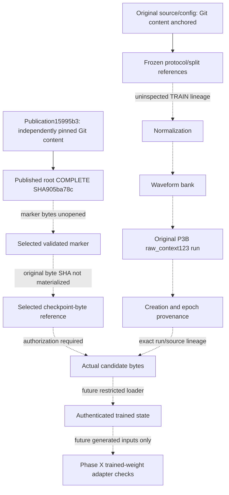

# Phase XI-A provenance evidence graph v1

The full machine-readable graph has14 nodes and13 edges in `reports/mist_cove/phase11a_v1/provenance_graph.json`. Every edge identifies required/available evidence, sources, typed links, independence, direct versus inferred linkage, cryptographic/reference status, falsifier and missing dependency. No actual artifact has a Level3 edge.

**Level1:** records are self-consistent, without an independent anchor. **Level2:** a record/reference is bound to an independently preserved historical publication. **Level3:** actual authorized artifact bytes match the trusted historical reference. A parsed source contract alone is not a completed cryptographic edge. A Level2 reference to a marker's hash does not authenticate that marker's uninspected bytes or its descendants.

The P3B root SHA905ba78cf8326594a431ce7a71ce9624c35814d2e76c94f57abda8afbe7c7e7d is published twice in the same reporting commit15995b3. Those two representations cross-check transcription, not independent replications. Frozen code says the root hashes selected per-run markers and checkpoint outputs. The next edges remain inferred until a separately authorized receipt-only read validates the root and exact selected child. No direct original best checkpoint-byte value is invented.

The user-pinned Phase X commit binds historical Git content and ancestry. Object IDs/hash comparisons verify content, while unsigned commits and author dates do not establish an external signer or trusted wall-clock chronology. This explicit trust assumption is narrower than source-artifact authentication or an independent clinical audit.

Phase III published COMPLETE_SEAL references belong to their own experiment. They form a parallel potential chain, not a bridge authenticating P3B. Matching F1, architecture, names or seed cannot create that missing edge. A new local sidecar cannot replace an independently pinned original root.

The small synthetic verifier graph can reach fixture-only Level3 because its independent in-memory anchor and generated original bytes are both controlled and retained before adversarial changes. That result must never promote this historical graph to Level3 or unlock real access.
