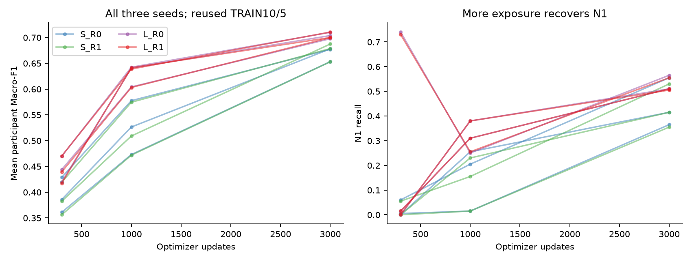
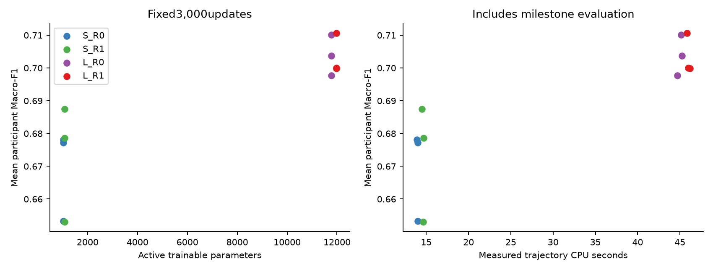
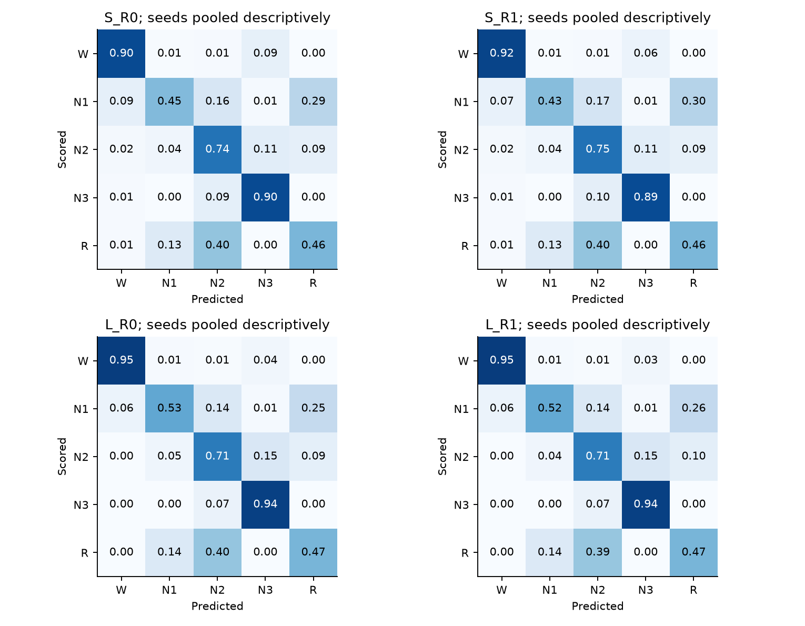
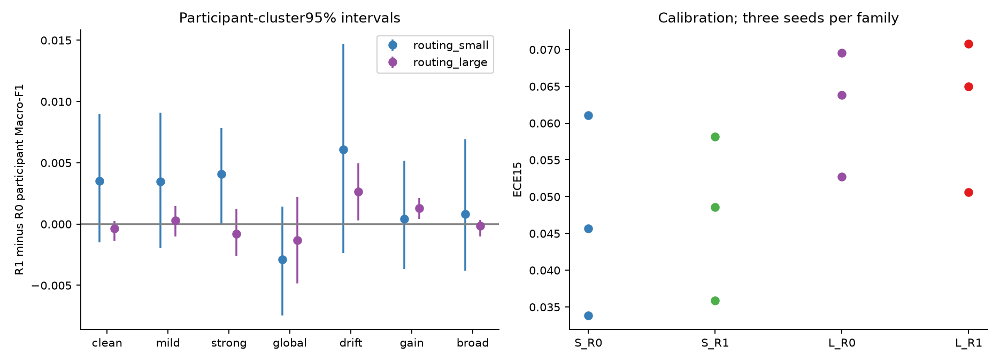

# Phase XIII model adequacy results v1

The exposure hypothesis passes. Absolute larger-model adequacy passes. The prespecified all-seed width improvement and reliability-routing promotion gates fail. These are developmental findings on the reused TRAIN10/5 allocation, not untouched-subject or clinical validation.

Twelve trajectories completed3,000updates each, with sealed300/1,000/3,000 milestones, unchanged Adam.001 and paired classification CE. All intended gradients and updates remained finite. Identical example/atom/phase draw hashes match across width and routing for every seed and checkpoint. Fit group4,884examples from10people; internal development1,000examples from5people. Missing116fit-stratum positions are retained as missing. The original model and its fitting are unchanged. No new raw VAL or excluded-source reads occurred.

| Capacity/route | Updates | Participant Macro-F1 seeds123/456/789 | N1 recall seeds123/456/789 | Fit-monitor Macro-F1 seeds123/456/789 |
|---|---:|---|---|---|
|S/R0|300|0.3609/0.3856/0.4286|0.005/0.060/0.000|0.444/0.491/0.530|
|S/R0|1000|0.4730/0.5264/0.5775|0.015/0.205/0.255|0.537/0.571/0.652|
|S/R0|3000|0.6532/0.6781/0.6772|0.365/0.555/0.415|0.701/0.712/0.730|
|S/R1|300|0.3562/0.3824/0.4192|0.000/0.055/0.000|0.445/0.490/0.519|
|S/R1|1000|0.4718/0.5090/0.5745|0.015/0.155/0.230|0.572/0.577/0.649|
|S/R1|3000|0.6529/0.6874/0.6786|0.355/0.530/0.415|0.716/0.720/0.735|
|L/R0|300|0.4697/0.4438/0.4199|0.015/0.740/0.000|0.570/0.477/0.522|
|L/R0|1000|0.6424/0.6042/0.6407|0.310/0.250/0.380|0.716/0.676/0.722|
|L/R0|3000|0.7101/0.6977/0.7038|0.510/0.565/0.510|0.769/0.778/0.768|
|L/R1|300|0.4702/0.4393/0.4175|0.015/0.730/0.000|0.566/0.468/0.530|
|L/R1|1000|0.6388/0.6031/0.6414|0.310/0.255/0.380|0.716/0.677/0.722|
|L/R1|3000|0.7106/0.6998/0.7000|0.510/0.555/0.505|0.770/0.782/0.765|

S stores1,078parameters (R0active1,029;R1active1,078). L stores11,974 (R0active11,781;R1active11,974). Both retain17sample convolutional receptive fields before atom pooling,15nonoverlapping200sample atoms,7global features, and one-epoch context. Width does not introduce new temporal context.

| Frozen gate | Per-seed outcome123/456/789 | Overall |
|---|---|---|
|absolute_adequacy|PASS/PASS/PASS|PASS|
|width|PASS/FAIL/FAIL|FAIL|
|exposure|PASS/PASS/PASS|PASS|
|routing|FAIL/FAIL/FAIL|FAIL|

Paired participant-cluster uncertainty (1,000draws,seed123; retain all optimization seeds inside each of5people):

| Contrast | View | Mean ΔMacro-F1 | Descriptive95% interval | Seed SD |
|---|---|---:|---|---:|
|exposure|clean|+0.27775|[+0.22266,+0.34541]|0.02530|
|exposure|strong_local_HF|+0.26629|[+0.21746,+0.31581]|0.03854|
|width|clean|+0.03436|[+0.02543,+0.04271]|0.01978|
|width|strong_local_HF|+0.05114|[+0.03594,+0.06509]|0.01527|
|routing_large|clean|-0.00038|[-0.00135,+0.00026]|0.00302|
|routing_large|strong_local_HF|-0.00081|[-0.00261,+0.00124]|0.00144|
|routing_small|clean|+0.00350|[-0.00149,+0.00894]|0.00515|
|routing_small|strong_local_HF|+0.00408|[-0.00002,+0.00784]|0.00501|

The S/R0 clean exposure gain is large in all seeds, with N1 recall changing from.005/.060/.000 to.365/.555/.415. The previously observed300-update weakness therefore cannot be taken as proof of an inherently incapable small architecture. Neither tiny-set memorization nor these five development people establish population adequacy. Both engineering probes reached100% ten-example accuracy, but S missed CE≤.1 (.29447) while L passed (.06643). Both passed exact model/optimizer/sampler resume checks; four additional verification updates are counted separately.

L/R0 final mean participantF1=.70384 versus S/R0=.66948. Width gives positive gains in all seeds, but only seed123 exceeds the frozen+.03 threshold; seed456=.01966 and789=.02658 fail it. The mean descriptive interval being positive does not override this all-seed gate. Further width tuning or extra seeds were not run. No complete class collapse remains in final states. N1 is recovered, while N2 and REM remain weaker than Wake/N3.

R1's L-width primary strong-local-HF ΔF1 averages−.00081, with an interval spanning zero; clean ΔF1=−.00038. The three final R1 gates at each width saturate near1: mean>.999, all observed clean gate values≥.95, tiny across-atom standard deviations, satisfying the frozen collapse diagnostic. Under the tested paired-CE objective, learned routing behaves nearly like fixed routing. This negative result is specific to this representation, objective, sampling and nuisance regime; it is not a universal impossibility result. No new reliability loss was added.

Training loss, gradients, parameter drift, predicted distributions, N2/N3 and REM/N2 confusion matrices, gate/evidence saturation, local/global magnitudes, error confidence, NLL/Brier/ECE15 and all7nuisance views are retained in each milestone aggregate JSON. S/R0 final ECE15mean=.04686 and L/R0=.06202; better classification did not uniformly improve calibration. Fit-monitor F1 remains above developmentF1; the monitor is a fixed500example subset, not the full training population. There is no evidence for declaring optimization converged at3,000updates or for claiming no overfit.

`stage_context_analysis.json` retains transition and physical-HF-proxy strata for each final state/view. `stage_adjusted_analysis.json` adds equal-stage within-person error differences and recording-F1 distributions without identifiers. Previous-stage transition errors are generally higher even after this descriptive matching. This association motivates a future context study, but no temporal-context architecture was tested and stage mismatch does not establish physiological ambiguity. High-HF power is an unvalidated quality proxy, not an expert artifact label. Incomplete stage coverage makes recording-level fixed-five F1 different from participant-level F1.

All reports preserve each seed. Bootstrap intervals describe five previously studied development people; they do not quantify all sources of seed, sample-selection, annotation or population uncertainty. Exploratory stage/view comparisons have no multiplicity-adjusted discovery claim. The historical P3B is a differently trained model on all15people and is not a fair width baseline. Reused historical VAL aggregates are contextual only; no new VAL evaluation or final all15fit was performed.

