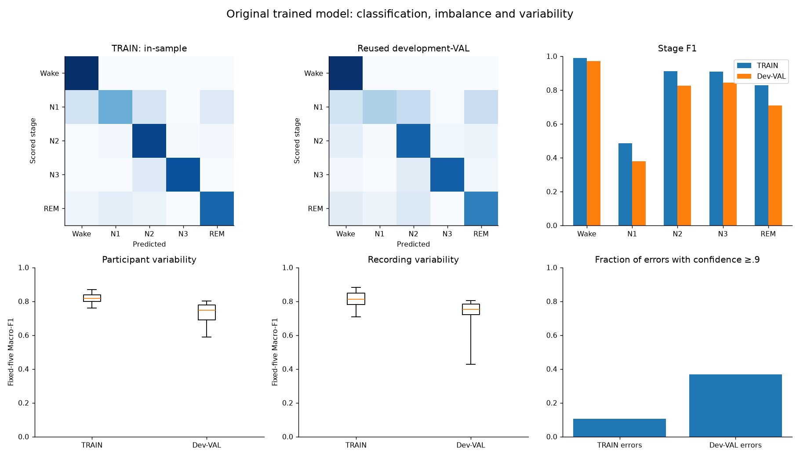
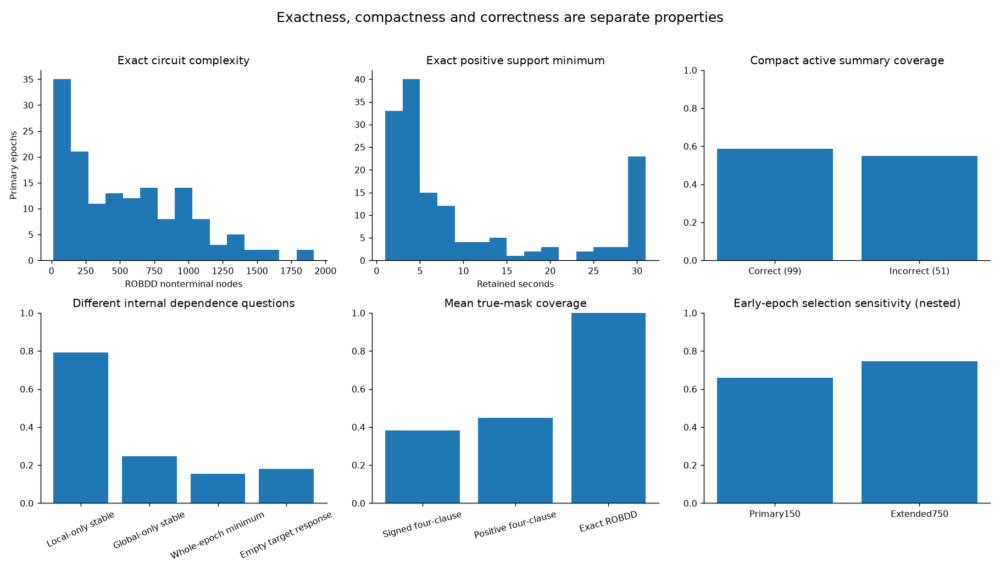
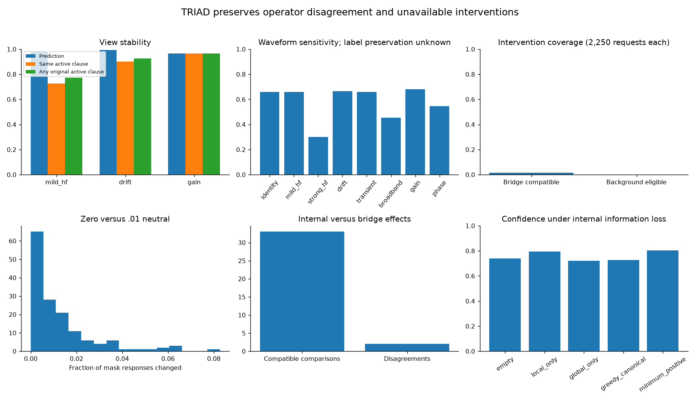
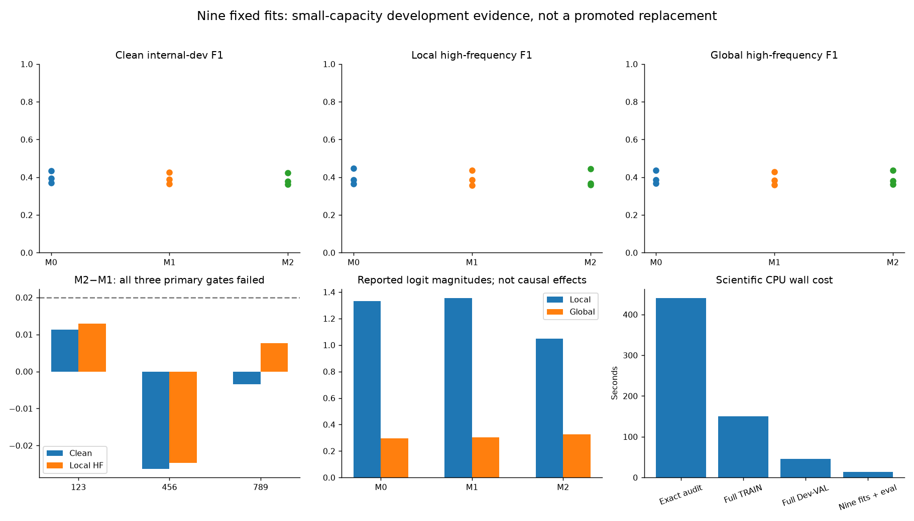

# MIST-COVE XI-B through XII-A aggregate dashboard

Original model authentication and exact internal circuits pass. The reliability-routing candidate fails its registered incremental gate in all three seeds. No clinical/external validation or new-method priority is claimed.

| Question | Result |
|---|---|
| Source coverage |15 TRAIN/4 reused development-VAL participants; no excluded cohorts|
| Full-grid scores |TRAIN F1 .824579; reused development-VAL F1 .745354|
| Primary explanations |150/150 exact;100 exact compact positive supports,86 displayed compact active clauses|
| Correctness limitation |28 wrong predictions have compact active explanations|
| Mild-HF stability |147 predictions stable,109 original active clauses stable|
| Intervention compatibility |33/2,250 bridges;0/2,250 eligible background requests|
| Matched training |9 fits/2,700 updates; M2−M1 mean local-HF F1 −.001400|
| Resources |664.292 scientific CPU seconds;0 GPU seconds;44.378 million cached-head queries|
| Final decision |No model promotion; stop for scientific review|

[Complete scientific answers and task table](../../../docs/mist_cove/PHASE_XII_SCIENTIFIC_DECISION_V1.md) · [Model authentication](../../../docs/mist_cove/PHASE_XIB_AUTHENTICATED_MODEL_RESULTS_V1.md) · [Real EEG results](../../../docs/mist_cove/PHASE_XIC_REAL_EEG_RESULTS_V1.md) · [TRIAD/results](../../../docs/mist_cove/PHASE_XII_MIST_TRIAD_RESULTS_V1.md) · [Frozen model development](../../../docs/mist_cove/PHASE_XII_MODEL_DEVELOPMENT_V1.md) · [Task ledger](progress.json) · [Resource receipt](resource_receipts.json)

All figures contain aggregate statistics. Private waveforms, fitted values, subject identities, epoch coordinates, complete predictions and weights remain outside Git. Error bars/intervals are descriptive participant-clustered estimates, not independent clinical validation. Stage-balanced early-epoch samples differ from whole-night prevalence, and extended examples include the primary sample.
