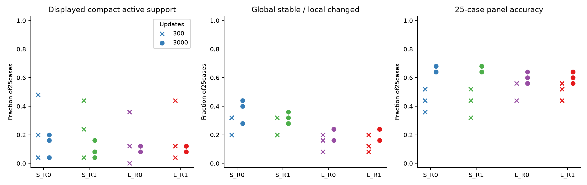
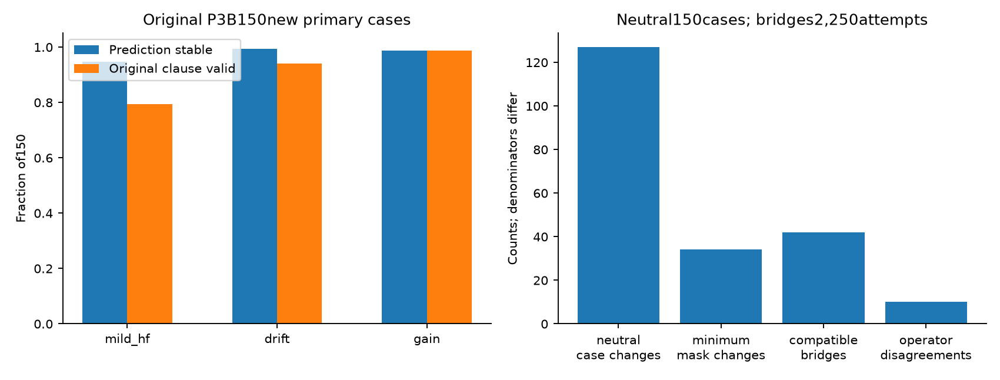

# Phase XIII aggregate dashboard

**Decision: exposure supported; width/routing incremental gates fail; physiological validity NOT TESTED.** No approved qualified reviewers are available. All independently authorized scientific execution is complete; publication closes with exact-head CI. No next phase starts.

| Frozen result | Status | Evidence |
|---|---|---|
| Blinded review infrastructure | Engineering PASS |150primary+30secondary+15duplicate presentations; private local app/export/QA |
| Genuine human validation | NOT TESTED / BLOCKED |User confirmed no approved qualified reviewers |
| Absolute L/R0 adequacy | Scientific PASS |All3seeds meet frozen stage/class/participant criteria |
| S/R0 extra exposure | Scientific PASS |Mean participantF1gain+.27775; N1recovers |
| Width incremental gate | Scientific FAIL |Only1/3seeds meets≥+.03clean gain |
| Routing incremental gate | Scientific FAIL |0/3seeds primary pass; near1gate saturation |
| Exact circuits | Engineering PASS |3,750tables×32,768masks; native identity bitwise |
| Physiological event interpretation | NOT TESTED |No independent event labels or target deletion |
| Resources | Within ceilings |12fits,36,000main updates;700.533scientific CPU seconds;GPU0 |
| Regression | PASS |1,112CPU tests;11CUDA skips |

Original primary panel:122/150correct,87/150exact compact nonempty positives,80/150displayed compact active explanations,27prior responses,126nonmonotone cases. Ten wrong predictions have compact displayed explanations. MildHF:142/150predictions stable versus119/150fixed clauses valid,5active substitutions. Neutral changes127tables/34positive minima. Compatible bridges42/2,250,with10operator disagreements; background0eligible/2,250.

Full [scientific decision and Q1–Q16](../../../docs/mist_cove/PHASE_XIII_SCIENTIFIC_DECISION_V1.md), [model results](../../../docs/mist_cove/PHASE_XIII_MODEL_ADEQUACY_RESULTS_V1.md), [expert validity status](../../../docs/mist_cove/PHASE_XIII_EXPLANATION_VALIDITY_V1.md), [TRIAD comparison](../../../docs/mist_cove/PHASE_XIII_TRIAD_COMPARISON_V1.md), [novelty/fairness](../../../docs/mist_cove/PHASE_XIII_NOVELTY_AND_FAIRNESS_V1.md).

Machine-readable receipts: [progress](progress.json), [gates](scientific_gates.json), [uncertainty](uncertainty_summary.json), [resources](resource_receipts.json), [scope](source_scope_receipt.json), [publication identities](publication_manifest.json). No participant IDs, waveforms, detailed coordinates, annotations, fitted values, model states or individual predictions are published. New TRAIN data access was authorized; new raw VAL/excluded-source reads and external transfers are zero.

Next decisive experiment: separately approved two-reviewer blinded local annotation of the frozen primary panel, followed by locked matched-control alignment. No additional training is justified by this phase alone.

