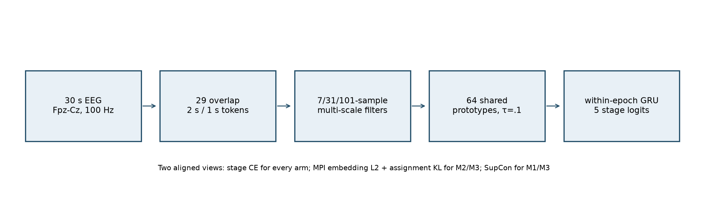
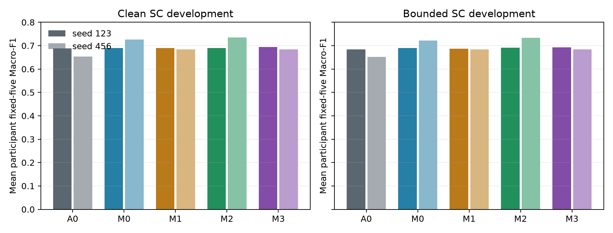
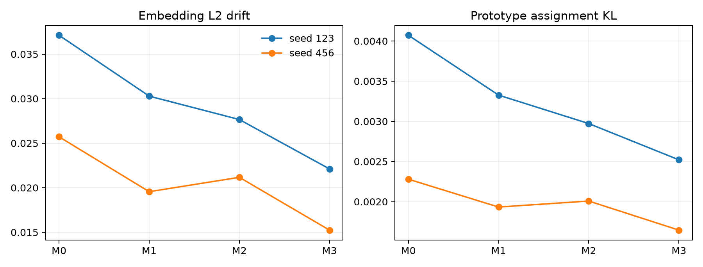
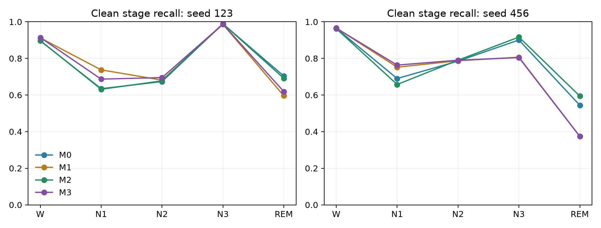

# MIST-Sleep Phase M0 dashboard

**Decision:** `MPI_FEASIBILITY_NOT_ESTABLISHED`. The M2–M0 bounded-nuisance participant Macro-F1 mean difference was **+0.00585**, below the frozen **+0.02** exploratory readiness threshold. Clean difference was **+0.00370**. These are reused SC TRAIN development results, not external transfer.

| Item | Measured status |
|---|---|
| Source | 29 authenticated original SC TRAIN recordings; 10 fit / five internal-development participants; zero SC VAL, RESERVED or external waveform reads |
| Scientific runs | Five arms × two fixed seeds, 1,200 steps each; 12,000 optimizer updates; 384,000 training views |
| Prototype bank | 64 units; fit-only warmup/k-means; identical k-means input digests within each seed; no dead M2 units |
| Bounded view | M2 lowers embedding L2 and prototype KL in both seeds; stage F1 gain misses gate |
| Destructive stress | All arms collapse to roughly 0.16–0.21 participant Macro-F1; not an external dataset test |
| Resources | 95.44 s observed GPU campaign wall; 91.6 MB peak GPU allocation; 65 engineering updates |
| Baseline | A0 is an adapted AttnSleep architecture reference, not a faithful published reproduction |
| Original source | 13-page text mirror integrated; original PDF byte-identical artifact pending |

The [experiment report](../../../docs/mist_sleep/OVERNIGHT_EXPERIMENT_RESULTS_V1.md), [scientific decision](../../../docs/mist_sleep/OVERNIGHT_SCIENTIFIC_DECISION_V1.md), [manuscript draft](../../../docs/mist_sleep/METHOD_PAPER_MANUSCRIPT_DRAFT_V1.md), [frozen protocol](frozen_protocol.json), [per-arm results](M2_123.json), [nuisance analysis](robustness_analysis.json), [stage probe](stage_information_probe.json) and [resource receipt](resource_receipts.json) contain the reviewable evidence.

